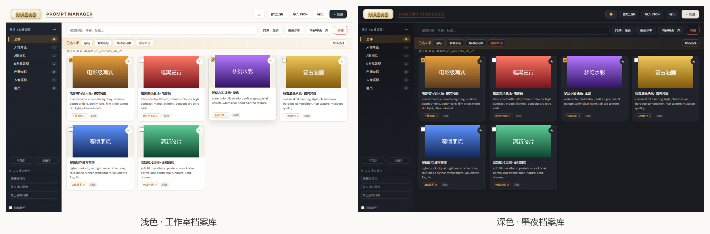

# MADAO Prompt Manager

> 📖 **详细使用教程见 [USAGE.md](USAGE.md)**：安装、三种存词方式、发送到 ComfyUI、批量操作、备份同步、常见问题。

一款开源的浏览器提示词管理扩展（Edge / Chrome，Manifest V3）。管理、搜索、调用 AI 绘图提示词，并与本地 ComfyUI **双向打通**：一键发送提示词进工作流，右键保存时自动抓取最近生成图当封面。



## ✨ 核心功能

### 提示词管理
- 卡片式库：缩略图、分类（支持子分类树 + 折叠）、标签、收藏、全文搜索
- 批量操作：常驻勾选框 + **Shift 范围选择**，批量复制 / 移动 / 删除
- 「清理超短提示词」：阈值可自定义，清单勾选式审查删除，防误删
- 导入 / 导出 JSON、CSV；本地文件夹双向同步；自动备份开关
- 数据三防线：独立缩略图库（`pm_thumbs_db`）+ 钉死主库（防自动翻转丢图）+ 迁移合并

### 🚀 与 ComfyUI 双向打通
- **发送到 ComfyUI**：替换 / 追加两种模式，自动找正向提示词节点。三级通道兜底：
  1. Lora Manager 接口直写画布 widget（推荐装 [ComfyUI-Lora-Manager](https://github.com/willmiao/ComfyUI-Lora-Manager)）
  2. LiteGraph 画布 API
  3. DOM textarea 兜底
- **右键存为提示词 → 自动抓封面**：在 ComfyUI 页面选中提示词右键保存，扩展自动读取最近一次生成成功的输出图（优先 SaveImage，压成 480px JPEG），编辑窗里封面已经填好
- ComfyUI 通道诊断：一键检查后台、接口、标签页连通性

### 🎨 双主题 UI
暖纸白「工作室档案库」× 暖炭黑「墨夜档案库」，顶栏一键切换、偏好持久化。

### 🛡 内容审查（可选）
内置 NSFW 检测模型（nsfwjs，纯本地推理），开关在工具栏。

## 📦 安装

1. 下载本仓库（`Code → Download ZIP` 或 `git clone`）
2. Edge：`edge://extensions` → 开启「开发人员模式」→「加载解压缩的扩展」选本目录
   Chrome：`chrome://extensions` 同上
3. 快捷键：`Alt+Q` 侧边栏 · `Alt+Shift+Q` 管理页

### ComfyUI 联动的前提
- ComfyUI 运行在 `http://127.0.0.1:8188`
- 「发送到工作流」推荐安装 [LoRA Manager](https://github.com/willmiao/ComfyUI-Lora-Manager)（通道 A 最精准；我们维护的增强版：[madao-comfyui-lora-manager](https://github.com/matawokou/madao-comfyui-lora-manager)）；不装也能用画布 / DOM 兜底通道
- 「自动封面」无需任何插件，只要 ComfyUI 开着

## 🔗 配套项目

- **[MADAO ComfyUI LoRA Manager](https://github.com/matawokou/madao-comfyui-lora-manager)** —— 上游 LoRA Manager 的本地增强 fork（GPLv3）：扫描后自动关联 CivitAI、LoRA 语法保留分类前缀、NSFW 一键开关等 7 项改进。与本扩展联动实现「提示词 ⇄ 工作流」双向打通。

## 🔒 隐私

- 所有数据（提示词、缩略图、设置）只存在本机浏览器（IndexedDB / chrome.storage）和你的本地文件夹
- 无任何遥测、无云端、无账号
- 访问 `<all_urls>` 权限仅用于：右键菜单收集所选文字、向本机 ComfyUI 注入提示词、页面内快速插入工具栏

## 📁 目录结构

```
├── background.js      # 后台：右键菜单、ComfyUI 注入、自动封面抓取
├── manager.html/js    # 管理页（卡片库、编辑器、批量、主题）
├── sidepanel.html/js  # 侧边栏快速调用
├── popup.html/js      # 弹窗
├── content.js         # 页面内工具栏
└── lib/               # 存储 / UI / NSFW 模型
```

## 📜 License

[MIT](LICENSE)
